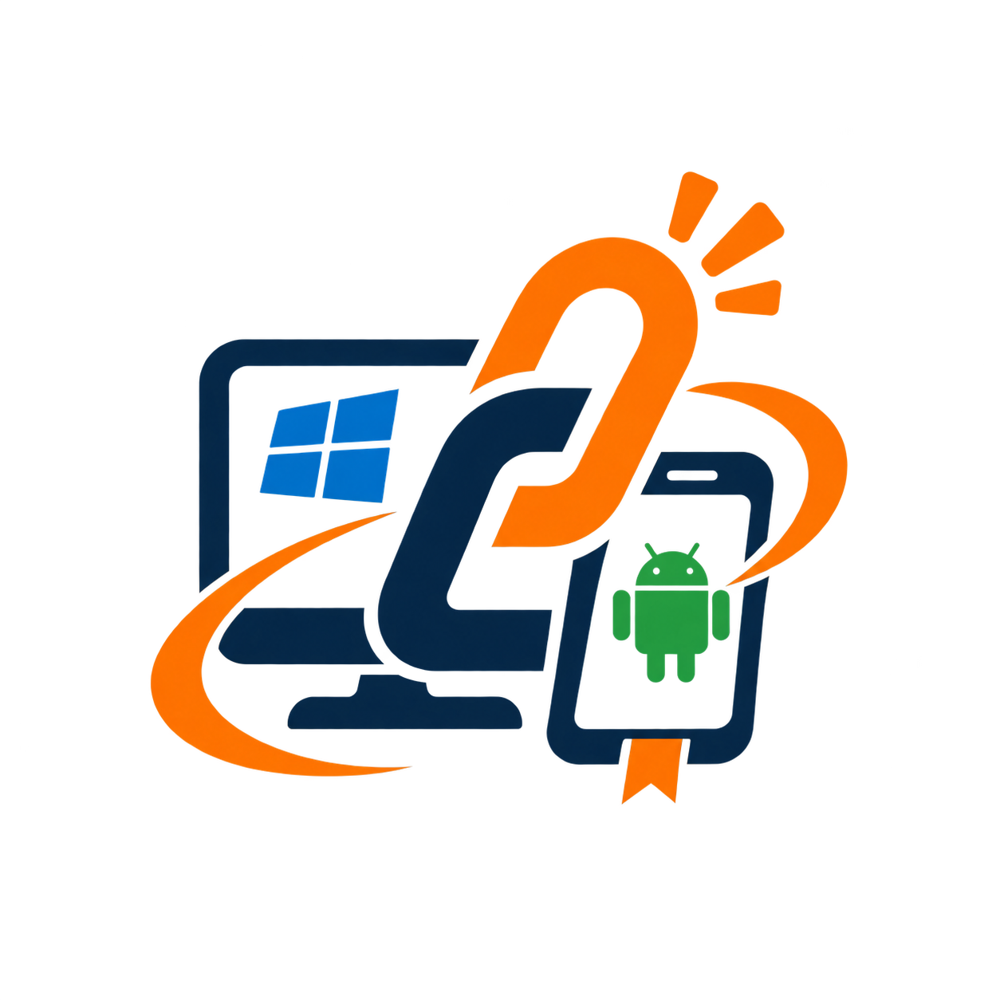

<div align="center">



# Linkroid

**Your Android phone and PC, working as one.**

Notifications, messages, calls, clipboard sync, file transfers, photos, and 60fps screen mirroring between Android and Windows or Linux.

Fast, local-first, peer-to-peer encrypted. No accounts. No cloud. 100% Free & Open Source.

[](https://github.com/webdevpraveen/linkroid/releases/latest)
[](https://github.com/webdevpraveen/linkroid/actions/workflows/ci.yml)
[](LICENSE)
[](LICENSE)

</div>

---

## ⚡ Highlights

* **🔔 Live Notifications & OTPs**: Mirror phone notifications in real time. Reply inline, run actions, and copy 1-time verification codes with one click.
* **💬 Messages & Calling**: Manage SMS, MMS, and unified chat threads (WhatsApp, Telegram, Signal) from your desktop. View caller ID, dial contacts, or answer calls hands-free.
* **📋 Universal Clipboard**: Instant bidirectional text and image copy-paste. Passwords from password managers are never sent.
* **📂 High-Speed File Transfers**: Move files and folders at full local Wi-Fi or USB speed. Features pause/resume, offline queuing, and LocalSend interop.
* **📁 Native Storage in File Explorer**: Mount your phone's storage directly into Windows File Explorer or Linux file managers.
* **📱 Low-Latency Screen Mirroring**: Stream your phone screen at up to 60fps with audio, or open individual Android apps in standalone PC windows (`app window`).
* **📷 Webcam & Continuity Camera**: Use your phone as a high-definition webcam for Zoom, Teams, Meet, or OBS. Snap photos or scan documents straight onto your PC clipboard.
* **🎨 Modern Themes**: Choose between **Bloom** (Material You), **Glass** (translucent frosted acrylic), **Graphite** (minimal monochrome / AMOLED), or **Hive** (warm amber).

---

## 📥 Download

| Platform | Download | Requirements |
| :--- | :--- | :--- |
| **Windows (x64)** | [Windows Installer (.exe)](https://github.com/webdevpraveen/linkroid/releases/download/v0.1.0/Linkroid-0.1.0-x64-setup.exe) | Windows 10 (2004+) or Windows 11 (64-bit) |
| **Windows (ARM64)** | [ARM64 Installer (.exe)](https://github.com/webdevpraveen/linkroid/releases/download/v0.1.0/Linkroid-0.1.0-arm64-setup.exe) | Windows 11 on ARM (Snapdragon / Copilot+ PC) |
| **Android** | [Android App (.apk)](https://github.com/webdevpraveen/linkroid/releases/download/v0.1.0/Linkroid-0.1.0-android.apk) | Android 8.0 (Oreo) or newer |
| **Linux (x86_64)** | [AppImage](https://github.com/webdevpraveen/linkroid/releases/download/v0.1.0/Linkroid-0.1.0-x86_64.AppImage) · [.deb](https://github.com/webdevpraveen/linkroid/releases/download/v0.1.0/linkroid_0.1.0_amd64.deb) · [.rpm](https://github.com/webdevpraveen/linkroid/releases/download/v0.1.0/linkroid-0.1.0-1.x86_64.rpm) | Ubuntu 24.04+, Fedora 40+, Debian 13 |

### Quick Install on Linux
```bash
curl -fsSL https://github.com/webdevpraveen/linkroid/releases/latest/download/install.sh | sh
```

---

## 🚀 Quick Start

1. **Install** Linkroid on your PC and your Android phone.
2. **Pair**: Open Linkroid on your PC and scan the QR code using the Linkroid phone app. (USB auto-pair and 6-digit nearby code are also supported).
3. **Connect**: That's it! Your devices establish an end-to-end encrypted connection immediately.

For complete setup guides, check the [User Guide](docs/guide/README.md).

---

## 🔒 Private by Design

* **Direct Local Connections**: Your data never leaves your local network. No external relay or third-party server can read your traffic.
* **End-to-End Encryption**: Every session is protected by QUIC with mutual TLS 1.3 using Ed25519 device keys exchanged during pairing.
* **Hardware-Backed Key Protection**: Device keys are sealed at rest using Windows DPAPI on PC and Android Keystore AES-256-GCM on phone.
* **Zero Telemetry**: No tracking, no analytics, no accounts, and no data harvesting.

---

## 🛠️ Architecture & Tech Stack

```
   Android App (Kotlin + Compose)          Desktop App (Qt Quick + Rust)
              │                                          │
              ▼ UniFFI                                   ▼ cxx-qt
   ┌─────────────────────────────────────────────────────────────────┐
   │                    linkroid-core (Rust)                         │
   │  Peer trust store · QUIC session transport · SQLite storage     │
   └─────────────────────────────────────────────────────────────────┘
```

* **Core**: Rust (`core/linkroid-core`, `core/linkroid-protocol`)
* **Desktop UI**: Qt Quick (QML) + C++ / Rust bridge (`cxx-qt`)
* **Android UI**: Kotlin + Jetpack Compose
* **Wire Protocol**: Length-prefixed CBOR over QUIC streams (`iroh`)

---

## 🔨 Building from Source

### Prerequisites
* **Rust**: Stable (via [rustup](https://rustup.rs))
* **Desktop**: Visual Studio 2022 C++ tools, [Qt 6.12](https://www.qt.io/)
* **Android**: Android SDK (API 34+), NDK, JDK 17+

### Build Commands
```bash
# Run tests across core Rust crates
cargo test --workspace

# Run Desktop app
cargo run -p linkroid-desktop

# Run CLI client
cargo run -p linkroid-cli -- --help

# Build Android APK
cd android && ./gradlew assembleDebug
```

---

## 📚 Documentation

* [User Guide](docs/guide/README.md) — Comprehensive guide for every feature and setting
* [Technical Architecture](docs/technical/architecture.md) — System design and internal crate layout
* [Protocol Specification](docs/protocol/v0.md) — Wire format, pairing ceremony, and capabilities

---

## 💬 Community & Contributing

* **Discussions**: Share ideas, feedback, and questions in [GitHub Discussions](https://github.com/webdevpraveen/linkroid/discussions).
* **Issues**: Report bugs with reproduction steps in [GitHub Issues](https://github.com/webdevpraveen/linkroid/issues).
* **Security**: For vulnerabilities, please refer to [SECURITY.md](SECURITY.md).

Developed by [Praveen (@webdevpraveen)](https://github.com/webdevpraveen). Contributions are welcome!

---

## 📄 License

* Desktop, Android apps, and CLI: [GPL-3.0-or-later](LICENSES/GPL-3.0-or-later.txt)
* Core libraries: [MPL-2.0](LICENSES/MPL-2.0.txt)
* Documentation: [CC BY 4.0](LICENSES/CC-BY-4.0.txt)
